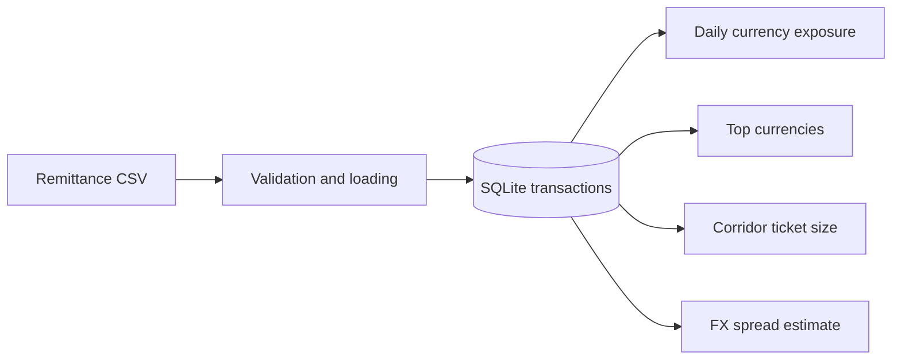

# Remittance FX Exposure Analyzer

> A small data-engineering and treasury-analytics project for measuring currency exposure, payment corridors, and estimated FX spread revenue.


## Overview

The script ingests a remittance transaction dataset into SQLite and answers four practical questions: how much exposure exists per currency and day, which currencies dominate volume, which transfer corridors have the largest average ticket, and what revenue a configurable FX spread could produce.



## Analyses

- daily exposure grouped by settlement currency;
- top currencies by total transaction volume;
- average ticket size for each source-destination corridor;
- realised-revenue estimate from a configurable basis-point spread;
- local persistence in a reusable SQLite database.

## Run locally

```bash
python -m venv .venv
# Windows: .venv\Scripts\activate
# macOS/Linux: source .venv/bin/activate
pip install pandas
python remittance_fx_exposure.py
```

The default input is `data/comprovantes_pix_10000_anomalias.csv`; the script creates or updates `remittance_fx.db`.

## Core functions

| Function | Output |
|---|---|
| `daily_currency_exposure` | date/currency exposure table |
| `top_currencies_by_volume` | largest currencies by processed value |
| `avg_ticket_size_by_corridor` | mean transfer amount per corridor |
| `realized_fx_revenue_estimate` | total and detailed spread-revenue estimate |

## Scope

This repository demonstrates analytics logic on a local dataset. It is not a production ledger, reconciliation system, or financial recommendation engine.
